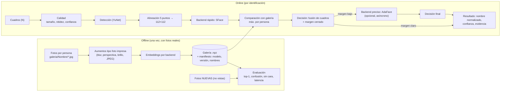

# Arquitectura del pipeline de reconocimiento facial

Estado: **diseño, sin implementar**. Fecha: 2026-11-11.
Objetivo: identificar a una persona entre un **conjunto cerrado** de compañeros (hoy 11) a partir de una foto impresa, con la **calidad** del modelo afinado de `turtlebot_face` y la **rapidez** de nuestro SFace.

## 1. Qué dice cada parte (README del zip frente a lo medido)

| Afirmación del README de `turtlebot_face` | Lo que comprobé | Consecuencia |
|---|---|---|
| ~190 ms por imagen (Mac M4) | Linux x86 (i5-12450HX): detector 260–680 ms + embedding 0.7–1.9 s por cara. En Windows 8–27 s | No sirve en hardware modesto; sí sirve como verificador asíncrono o en un equipo potente |
| 87 % de aciertos (162/186) con "foto impresa" sintética | Las imágenes salen de **las mismas fotos del registro** (lo dice el README) | Mide robustez, no generalización. Falta evaluarlo con fotos nuevas |
| "Afinado (ronda 2)" | El ONNX no guarda nada del entrenamiento; no vienen ni el dataset ni el script | No sabemos con quién se afinó. Hay que preguntarlo |
| `min_margen = 0` por defecto | Con 0, la persona buscada solo necesita ganar, aunque la diferencia sea ínfima | Para **identificar** hay que exigir margen (nosotros usamos 0.04 para "seguro") |
| Conjunto cerrado de 11 personas, 64 fotos | Confirmado en `registro.npz` (5–12 fotos por persona) | Misma hipótesis que nuestra competencia |
| ONNX = PyTorch (coseno 1.0), detector IoU 0.999 | No lo verifiqué | Se acepta con reserva |

Lo que **ya tenemos** y su pipeline no: calidad de cuadro (confianza × tamaño × nitidez), espejo de la galería, caché de embeddings, promedio de los mejores cuadros, deja-uno-fuera (`facial.py --probar`) y detector rápido (13–16 ms por imagen).
Lo que **tiene su pipeline** y nosotros no: un modelo de embedding mucho más fuerte, detección en cascada (segundo intento con más resolución) y elección de la cara con mayor margen cuando hay varias.

## 2. Arquitectura propuesta

### Componentes y contrato

| Componente | Responsabilidad | Entrada → salida |
|---|---|---|
| `Calidad` | Descarta cuadros malos y ordena los buenos | cuadro → puntaje (0–1) |
| `Detector` | Cajas y 5 puntos | cuadro → caras [(caja, puntos, confianza)] |
| `Backend` (interfaz) | Embedding intercambiable | cara alineada 112×112 → vector L2-normalizado. Implementaciones: `SFaceBackend` (128-d, rápido), `AdaFaceBackend` (512-d, preciso) |
| `Galeria` | Embeddings por persona, **uno por backend** | fotos → `.npz` con `modelo`, `dim`, `nombres`, `archivos` |
| `Decisor` | Fusiona cuadros y decide | similitudes por cuadro → (persona, score, margen, `seguro`) |
| `Normalizador` | Nombre legible y único | `angel_mora` → `Ángel Mora`, `Brigitte Rojas` → `Brigitte Rojas` (tabla de alias) |
| `Evaluador` | Mide con fotos nuevas | carpeta de prueba → métricas por backend |

Reglas de diseño:
- **Un backend = una galería**: nunca se compara un vector de SFace (128-d) con uno de AdaFace (512-d). El manifiesto lo impide.
- **Siempre responde algo** (como hoy) pero marca `seguro` solo con `score ≥ umbral` y `margen ≥ margen_min`.
- **Cascada:** el preciso solo corre cuando el rápido no es `seguro`. Se ejecuta como proceso aparte de baja prioridad, con tiempo máximo; si no termina, se queda con el resultado rápido.
- Configuración (umbrales, `top_frames`, `margen_min`, tiempo máximo del preciso) en `config.json`, no en el código.

## 3. Mejoras, por orden de valor

1. **Fotos nuevas y evaluación** (sin esto, todo lo demás es opinión). Es el trabajo previo a cualquier cambio de modelo.
2. **Galería aumentada** con efectos de foto impresa: sube el parecido entre galería y entrada sin costo en línea.
3. **Decisión por margen cerrado + fusión ponderada por calidad** en lugar de "mayor coseno medio": reduce confusiones entre compañeros parecidos.
4. **Umbral y margen calibrados** con el evaluador (hoy `UMBRAL=0.363` es el valor genérico de OpenCV, no el nuestro).
5. **Normalización de nombres** (`Brigitte Rojas` frente a `angel_mora`, acentos).
6. **Backend preciso opcional** (AdaFace) solo si el evaluador muestra que SFace mejorado no alcanza.
7. **Detección en cascada** (segundo intento a mayor resolución) si el evaluador muestra "sin cara" frecuentes.

Descartado: entrenar o destilar un modelo propio (sin datos, GPU ni tiempo) y cuantizar AdaFace a INT8 (la ganancia no cambia el orden de magnitud).

## 4. Protocolo de evaluación (criterios de aceptación)

- **Datos:** carpeta `fotos_prueba/<Nombre>/` con fotos **no usadas** en la galería ni en el registro; al menos Thiago_Frias y 2–3 compañeros más, 10–15 fotos cada uno.
- **Métricas por backend:** top-1; confusiones persona→persona (matriz); % sin cara detectada; % `seguro`; latencia mediana y p95 por identificación.
- **Aceptación:** top-1 ≥ 90 % con el decisor mejorado y **0 confusiones con `seguro=True`**; si SFace mejorado queda por debajo, se activa la cascada y se vuelve a medir.
- **No regresión:** deben seguir pasando `tests/test_facial.py` y el flujo de `mision.py` (`identificar(frames, rostros, galeria, umbral)`).

## 5. Cómo encaja con el código actual

`facial.py` ya expone `Rostros`, `Galeria`, `identificar(...)` y `Resultado`. La evolución es **aditiva**: se introduce la interfaz `Backend` detrás de `Rostros`, `Galeria` pasa a guardar el manifiesto, y `identificar` delega en `Decisor`. La firma pública y `Resultado` no cambian. AdaFace entra como paquete opcional (no es dependencia obligatoria).

## 6. Riesgos y preguntas abiertas

- ¿Con quién se afinó AdaFace y qué fotos quedaron fuera del entrenamiento? (Pregunta para quien lo hizo.)
- `onnxruntime` y los pesos de 261 MB tendrían que llevarse ya descargados: no hay internet en el laboratorio.
- Los pesos de SCRFD son solo para investigación no comercial.
- Con 11 personas de 5–6 fotos, el margen entre compañeros parecidos puede ser pequeño: el evaluador debe mostrar la matriz de confusión, no solo el promedio.
