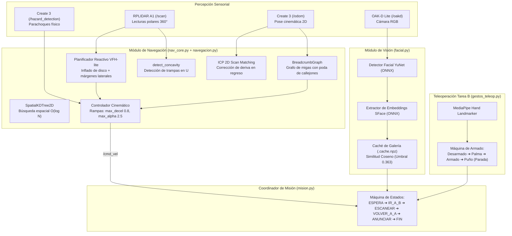

# Arquitectura del Sistema de Navegación y Visión · TurtleBot 4

El sistema está diseñado bajo un paradigma modular y reactivo para garantizar máxima robustez en entornos ciegos (sin mapa previo), mínimo consumo computacional y cero dependencia de conexiones de red durante la competencia.

---

## 1. Coordinador de Misión (`mision.py`)

Implementa la máquina de estados sincrónica que orquesta el ciclo de vida de la competencia:
1. **`ESPERA`:** Valida que los tópicos `/scan` y `/odom` estén frescos, captura la pose inicial $A$ y su scan como Keyframe 0.
2. **`IR_A_B`:** Activa el piloto reactivo hacia la coordenada relativa de $B$. Registra periódicamente migas de pan (cada 20 cm) y keyframes LiDAR (cada 80 cm).
3. **`ESCANEAR`:** Al alcanzar $B$, se detiene y activa la cámara OAK-D Lite para capturar múltiples fotogramas de la fotografía colocada en el pedestal, seleccionando el cuadro más nítido para clasificarlo con SFace.
4. **`VOLVER_A_A`:** Invierte el objetivo siguiendo las migas del `BreadcrumbGraph`. A medida que transita, corrige la deriva odometría acumulada mediante **ICP 2D** contra los keyframes registrados en la ida.
5. **`ANUNCIAR`:** Al arribar a $A$ dentro del umbral de tolerancia, el robot reproduce verbalmente el nombre del individuo identificado y publica el evento en `/nombre_reconocido`.
6. **`FIN`:** Detiene los motores, consolida el tiempo total en el cronómetro y genera el reporte JSON de la misión.

---

## 2. Planificación Reactiva y Estructuras de Datos (`nav_core.py`)

- **VFH-lite (Vector Field Histogram ligero):**
  - Evalúa 73 rumbos candidatos en un abanico continuo de $[-180^\circ, +180^\circ]$ cada $5^\circ$.
  - Modela el cuerpo del robot como un disco inflado ($R_{\text{robot}} + \text{margen} \approx 26\text{ cm}$).
  - Función de costo multicriterio: minimiza desviación hacia la meta ($w_{\text{goal}}$), penaliza cambios bruscos de dirección ($w_{\text{turn}}$) y maximiza la holgura libre lateral ($w_{\text{clear}}$).
- **`SpatialKDTree2D`:**
  - Estructura arbórea de partición espacial 2D pura en NumPy/Python.
  - Ofrece consultas de vecino más cercano (`nearest`) y de radio (`query_radius`) en $O(\log N)$ sin requerir librerías externas como `scipy`.
  - Permite la deduplicación espacial de obstáculos virtuales (`VirtualObstacles`), evitando sobrecarga en memoria.
- **`BreadcrumbGraph` con Poda de Callejones:**
  - Modela el rastro del robot como un grafo conexo de waypoints.
  - Al ingresar a un callejón sin salida o experimentar un atasco, el método `prune_branch` marca como inactivas las migas pertenecientes a esa bifurcación fallida.
  - Durante el retorno a $A$, el selector `pick_waypoint` ignora los nodos podados, asegurando que el robot no reingrese en trampas exploradas previamente.
- **Detector de Concavidades (`detect_concavity`):**
  - Mide la envolvente angular LiDAR en el cuadrante frontal. Si detecta que la meta está encerrada en una concavidad en forma de "U" a menos de $0.75\text{ m}$, alerta al piloto para rodear el obstáculo antes de encajonar el vehículo.

---

## 3. Control Cinemático y Suavizado (`navegacion.py`)

- **Modulación Continua de Giro (*Smooth Blending*):**
  - Se sustituyó el corte abrupto de avance a $60^\circ$ por una función continua basada en el coseno del error angular:
    $$\text{turn\_scale} = \max\left(0, \frac{\cos(\theta) - \cos(\theta_{\text{tip}})}{1 - \cos(\theta_{\text{tip}})}\right)$$
  - Elimina el cabeceo del TurtleBot al tomar curvas.
- **Rampa de Desaceleración Suave (`max_decel = 0.8 m/s²`):**
  - Previene que las ruedas del Create 3 derrapen ante paradas imprevistas, conservando la precisión de la odometría de las ruedas.
- **Rampa de Aceleración Angular (`max_alpha = 2.5 rad/s²`):**
  - Evita tirones bruscos de los motores de tracción diferencial.
- **Respuesta Ultrarrápida a Bumper:**
  - Suscrito directamente a `/hazard_detection` del Create 3. Al registrar contacto físico, aborta la marcha en $< 50\text{ ms}$, retrocede controladamente y coloca una barrera virtual en la boca del obstáculo.

---

## 4. Visión Artificial y Reconocimiento Facial (`facial.py`)

- **Pipeline Offline (Sin Dependencia de Internet):**
  - **Detección:** Modelo YuNet (`face_detection_yunet_2023mar.onnx`) de OpenCV Zoo, ultra-rápido en CPU ARM64 / x86.
  - **Reconocimiento:** Modelo SFace (`face_recognition_sface_2021dec.onnx`) que proyecta cada rostro en un vector unitario de 128 dimensiones.
- **Cálculo de Métrica:** Similitud Coseno entre el vector del frame y los embeddings pre-calculados de la galería:
  $$\text{similitud}(u, v) = \frac{u \cdot v}{\|u\| \|v\|}$$
  Umbral óptimo oficial de SFace: **0.363**.
- **Filtro de Calidad por Nitidez:**
  - Evalúa la varianza del operador Laplaciano en el recorte del rostro; descarta cuadros desenfocados por el movimiento del robot y procesa únicamente el frame con mayor contraste.
- **Caché Pre-computado:**
  - Los vectores de la carpeta `galeria/` se serializan en `.cache.npz`, arrancando el nodo de visión en menos de 0.05 segundos en el momento de la prueba.

---

## 5. Control por Gestos para la Tarea B (`gestos_teleop.py`)

- Basado en **MediaPipe Hand Landmarker** (21 puntos clave por mano).
- Diseñado para operar **sin periféricos físicos** (teclado/ratón prohibidos por lineamientos):
  - **Palma abierta sostenida (2 segundos):** Arma el sistema de movimiento (cambia estado a `ARMADO`).
  - **Mano inclinada o desplazada:** Comanda avance lineal proporcional y giro diferencial.
  - **Puño cerrado o pérdida de mano:** Desarmado instantáneo y parada de seguridad (`lineal = 0.0, angular = 0.0`).
  - **Gesto de Victoria ("V"):** Activa el escaneo y reconocimiento facial al llegar a $B$.
