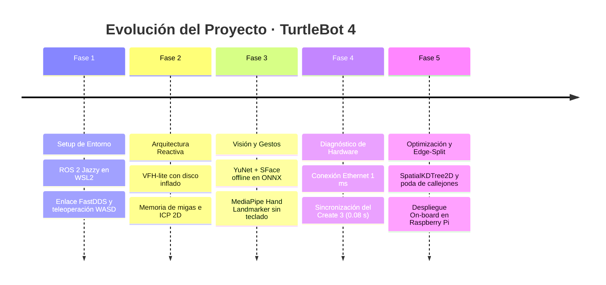

# Consolidado General de Avances del Proyecto Final 🚀📈

Este documento resume la trayectoria técnica completa del equipo, desde la configuración inicial del entorno hasta el estado actual del sistema listo para competir.

---

## 📅 Línea de Tiempo de Hitos Alcanzados

---

## 🔍 Detalle de Avances por Módulo

### 1. Hardware y Conectividad
- **Enlace Físico Ethernet:** Establecido enlace directo punto a punto (`192.168.185.10` laptop $\leftrightarrow$ `192.168.185.3` TurtleBot) con latencia constante $< 1\text{ ms}$, eliminando las caídas de paquetes y restricciones de multicast de las redes Wi-Fi del campus.
- **Solución al Reloj del Create 3:** Descubrimiento e integración del endpoint web privado `POST http://192.168.186.2/api/restart-ntpd`, reduciendo el desfase temporal de **20.9 horas a 0.08 s** en solo 2 segundos.
- **Salud del Sistema:** Raspberry Pi 4 sin subvoltaje (`throttled=0x0`), temperatura controlada a 55.5 °C y enlace USB 3.0 SuperSpeed (5000 Mbps) con la cámara OAK-D Lite.

### 2. Navegación Autónoma (Tarea A)
- **Superación de la Sobrecarga de Nav2:** Se determinó que correr Nav2 con controlador MPPI saturaba los 4 núcleos de la Raspberry Pi al 100%. Se reemplazó por la arquitectura reactiva **VFH-lite + migas + ICP 2D**, reduciendo el consumo de CPU a bordo a **< 5%**.
- **Cinemática Suave:** Implementación de modulación continua de velocidad lineal mediante coseno del error angular (*Smooth Blending*), rampa de frenado suave (`max_decel = 0.8 m/s²`) y aceleración angular controlada (`max_alpha = 2.5 rad/s²`).
- **Respuesta a Bumper:** Integración con `/hazard_detection` del Create 3 con tiempo de respuesta inferior a 50 ms y colocación automática de barreras virtuales.
- **Estructuras de Datos Avanzadas:**
  - `SpatialKDTree2D`: Árbol espacial puro en NumPy para consultas en $O(\log N)$ y deduplicación de obstáculos virtuales.
  - `BreadcrumbGraph`: Grafo topológico con poda de ramas de callejones (`prune_branch`) para evitar reingresos cíclicos en el retorno $B \to A$.
  - `detect_concavity`: Detector preventivo de trampas en forma de "U" en el perfil LiDAR.

### 3. Visión por Computador y Reconocimiento Facial
- **Pipeline 100% Offline:** Modelos ONNX de YuNet (detección) y SFace (reconocimiento) almacenados localmente en el repositorio.
- **Cálculo de Similitud Coseno:** Umbral oficial calibrado en 0.363 para embeddings de 128 dimensiones.
- **Filtro de Nitidez Laplaciana:** Algoritmo que evalúa múltiples fotogramas durante el escaneo en $B$ y selecciona el cuadro con mayor definición para evitar errores por desenfoque de movimiento.
- **Caché Pre-computado:** Almacenamiento de embeddings de la galería en `.cache.npz` con arranque en menos de 50 ms.

### 4. Teleoperación por Gestos (Tarea B)
- **Eliminación Total de Periféricos:** Diseñado para cumplir la regla estricta de no usar teclado, mouse ni joystick.
- **MediaPipe Hand Landmarker:** Detección de 21 puntos anatómicos por mano.
- **Máquina de Armado Seguro:** Requiere palma abierta durante 2 segundos para habilitar el movimiento; puño cerrado o pérdida de detección frena el robot instantáneamente por seguridad.
- **Gesto de Victoria ("V"):** Activa el escaneo en la meta $B$ sin tocar la laptop.

### 5. Calidad y Validación de Código
- **62 Pruebas Unitarias Aprobadas (100% de éxito en ~7.5 s):** Cubren toda la geometría de evasión, estructuras de datos, visión, cinemática y misiones simuladas de punta a punta.
- **Simulador 2D en Laboratorio:** Herramienta interactiva (`robot_simulado.py`) para probar circuitos de cualquier forma geométrica sin arriesgar el robot físico.
- **Despliegue a Bordo (*Edge Execution*):** Script de sincronización e instalación automática [`desplegar_en_robot.sh`](../../desplegar_en_robot.sh) y lanzadores locales `tarea_a_onboard.sh` y `tarea_b_onboard.sh`.
